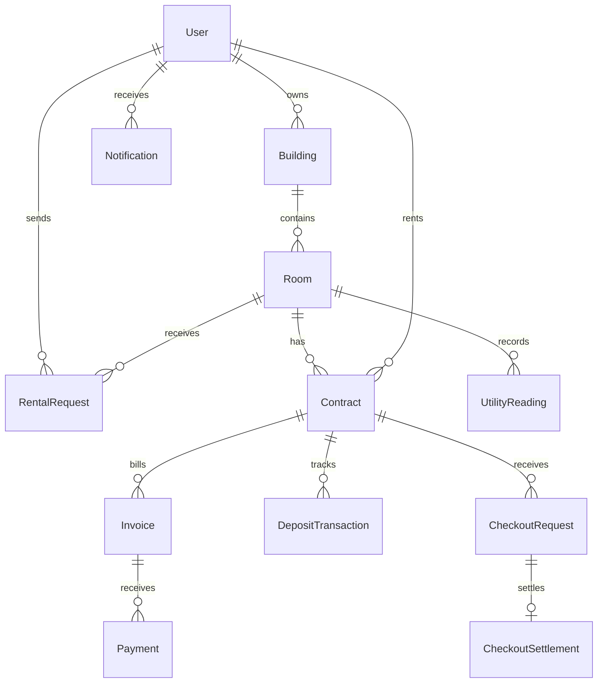

# Thiết kế MongoDB — quản lý trọ

Database local: `boarding_house`. Chạy `npm --prefix server run db:init` để tạo collection và index; script không xóa dữ liệu, không reset mật khẩu, không drop index. Các model nằm trong `server/src/models` và được export tại `server/src/models/index.js`.

## Collection và use case

| Collection          | Nội dung                                                               | Use case          |
| ------------------- | ---------------------------------------------------------------------- | ----------------- |
| users               | Tài khoản, hash mật khẩu, role, emailVerifiedAt, active                | 1–6, 9            |
| otpchallenges       | Hash OTP, mục đích xác thực/reset, số lần thử, hạn dùng                | 4, 5, 40          |
| buildings           | Dãy trọ, địa chỉ, chủ trọ, quản lý được phân công                      | 7, 10             |
| rooms               | Phòng, dãy, mã phòng, giá thuê, trạng thái, diện tích/sức chứa         | 8, 13, 17, 33     |
| tenantprofiles      | Hồ sơ người thuê, liên hệ khẩn cấp                                     | 11                |
| rentalrequests      | Yêu cầu thuê, trạng thái và người xử lý                                | 18–20             |
| contracts           | Hợp đồng, kỳ thuê, tiền thuê/cọc, người duyệt, bản chụp chính sách/phí | 12, 21, 22, 34    |
| utilityrates        | Đơn giá điện nước theo dãy và ngày hiệu lực                            | 14                |
| servicefees         | Dịch vụ/phí theo dãy, đơn vị tháng/người/sử dụng                       | 15                |
| contractpolicies    | Chính sách theo dãy và phiên bản                                       | 16                |
| utilityreadings     | Chỉ số cũ/mới điện nước theo phòng và tháng                            | 23                |
| checkoutrequests    | Yêu cầu trả phòng                                                      | 24, 37            |
| checkoutsettlements | Kiểm tra phòng, công nợ, khấu trừ cọc, hoàn trả                        | 25                |
| deposittransactions | Sổ tiền cọc: nhận, cấn trừ, hoàn                                       | 26                |
| invoices            | Hóa đơn tháng, dòng tiền phòng/điện/nước/phí, tổng tiền                | 27, 30, 32, 35    |
| payments            | Khoản thanh toán, trạng thái, mã chống xử lý trùng                     | 28–31, 38, 39, 41 |
| paymentevents       | Tiếp nhận sự kiện cổng thanh toán, trạng thái xác minh/xử lý           | 29, 41            |
| notifications       | Thông báo trong ứng dụng, thời điểm đã đọc                             | 27, 36            |
| emaildeliveries     | Hàng đợi/nhật ký gửi email và thử lại                                  | 27, 40            |
| auditlogs           | Nhật ký người thao tác trên dữ liệu nghiệp vụ                          | Theo dõi quản trị |

Collection sessions do connect-mongo quản lý khi ứng dụng chạy, không phải entity nghiệp vụ.

## Quan hệ



ObjectId/ref không phải khóa ngoại được MongoDB tự kiểm tra. Service phải kiểm tra bản ghi tham chiếu tồn tại, đúng role và thuộc cùng dãy/phòng/hợp đồng.

## Quy ước và ràng buộc

- Tiền lưu số nguyên VNĐ, không âm, trong Number.MAX_SAFE_INTEGER; giao dịch thanh toán/cọc phải lớn hơn 0. Số lượng/chỉ số cho phép phần lẻ; thành tiền làm tròn một lần trên từng dòng hóa đơn.
- Kỳ hóa đơn/chỉ số dạng YYYY-MM; ngày giờ lưu Date (UTC), hiển thị theo múi giờ Việt Nam.
- Một mã phòng duy nhất trong từng dãy; phòng cũ chưa gắn dãy vẫn hoạt động. Không tự tạo dãy hoặc thay đổi phân công dữ liệu cũ.
- Mỗi phòng có một bản ghi điện/nước mỗi tháng. Mỗi hợp đồng có một hóa đơn mỗi tháng; hóa đơn VOID vẫn giữ khóa để không tạo thêm hóa đơn cùng kỳ. Nếu cần hóa đơn điều chỉnh riêng phải mở rộng loại hóa đơn và khóa nghiệp vụ.
- Một hợp đồng APPROVED/ACTIVE giữ phòng qua occupiesRoom và unique partial index; save/create đồng bộ cờ này. Nhiều hợp đồng DRAFT có thể cùng phòng.
- Một yêu cầu thuê PENDING cho mỗi người/phòng; một yêu cầu trả phòng PENDING/APPROVED cho mỗi hợp đồng.
- Payment có idempotencyKey duy nhất; provider + providerTransactionId duy nhất. Event cổng thanh toán có provider + eventId duy nhất.
- OTP chỉ lưu hash, mặc định không đưa hash vào query result. TTL index dọn bản ghi hết hạn; TTL không xóa ngay lập tức nên service vẫn phải kiểm tra expiresAt, consumedAt và attempts. Cần hash/HMAC với secret, giới hạn gửi/thử OTP, và consume nguyên tử; schema không tự thực hiện các bước này.
- Không lưu mật khẩu rõ, OTP rõ, số thẻ hoặc secret cổng thanh toán trong collection. EmailDelivery chỉ chứa dữ liệu gửi tối thiểu, không chứa mã OTP.

## Phạm vi dữ liệu và nghiệp vụ

API hiện dùng các model cho người dùng, dãy trọ, phòng, lịch sử giá, hợp đồng, chính sách/phí, chỉ số điện nước, hóa đơn, dashboard và báo cáo. Room.manager vẫn được dùng để kiểm soát quyền theo phòng; Building.manager dùng để quản lý phân công ở cấp dãy.

Các model về giao dịch thanh toán, trả phòng, OTP, notification và email được giữ trong registry dữ liệu. Luồng thanh toán trực tuyến, quyết toán trả phòng và gửi email nền cần tích hợp dịch vụ riêng trước khi dùng thực tế.

Validation trong model chạy qua Mongoose; ghi trực tiếp bằng Compass/raw driver có thể bỏ qua validation ứng dụng nhưng vẫn chịu unique index. Hook `pre('validate')` không chạy trên `updateOne`/`findOneAndUpdate`; các cập nhật nghiệp vụ cần kiểm tra dữ liệu trong service hoặc tải document rồi gọi `save()`.

Giao dịch nhiều document cần MongoDB replica set (hoặc Atlas). Nếu triển khai các luồng giữ phòng, ghi thanh toán hoặc quyết toán cọc theo transaction, cần xác nhận môi trường database đã hỗ trợ replica set.

Chạy bộ kiểm thử tách biệt với database local:

```powershell
npm --prefix server test
```
